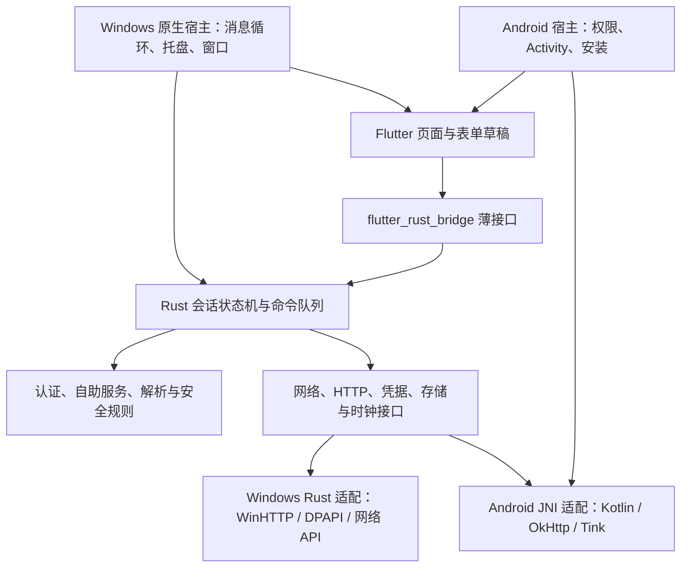

# Flutter + Rust 架构可行性与迁移方案

评估日期：2026-11-05。代码基线：`36dc38c`。范围：先统一 Android 与 Windows，其他平台保留扩展边界。

本文是基于现有源码与官方文档的架构提案，尚未通过 Flutter 原型验证；不表示迁移已经实施，也不替代当前 `AGENTS.md` 的构建、安装和发布约定。

## 1. 结论

**可行，建议采用“Flutter 展示层 + Rust 业务内核 + 原生平台适配”，先抽取内核，再逐端替换界面。**

收益主要是统一认证、自助服务、会话一致性、错误处理和界面组件的维护。现有 Windows Rust 代码可作为内核起点，Android 的接口分层、无感知功能和测试则是补齐行为的重要依据。迁移不能只把 Windows 业务代码原样导出给 Dart。

成本主要来自平台能力接入、旧数据兼容、Windows 宿主生命周期，以及两套 UI 的重写。Flutter 不会消除 Kotlin、Win32 和 Windows runner 的少量 C++ 代码。也不应预先承诺更小的安装包、更低的内存占用或固定的代码复用比例。

建议先完成两个技术原型：Windows 窗口销毁/重建与后台常驻；Android 指定物理 Wi-Fi 下的请求、取消与凭据访问。通过后再进入全面迁移。

## 2. 当前代码能复用什么

以下路径中 Android 的 Kotlin 文件位于 `android/app/src/main/java/top/steins/autologin/`。

| 现有部分 | 观察 | 迁移处理 |
|---|---|---|
| `windows/src/domain.rs` | 模型、登录结果解析、编码及规则基本不依赖 Windows | 优先抽取；将展示与业务模型进一步分离 |
| `windows/src/maintenance.rs` | 退避、暂停、截止时间规则独立 | 复用规则及测试；宿主决定是否允许持续运行 |
| `windows/src/network.rs`、`account.rs` | 已有可注入的局部 `Transport`，但仍直接引用 WinHTTP、网络快照和 Windows 文案 | 抽取协议与解析，统一注入传输、网络和会话接口 |
| `windows/src/app.rs` | 单工作线程串行操作，状态归属清楚；`Worker::start(window)` 通过 `PostMessageW` 通知界面 | 保留单写者模型，拆除 HWND、启动项、具体存储及展示文案耦合 |
| `windows/src/storage.rs` | DPAPI、JSON 格式和 `MoveFileExW` 原子替换 | 留在 Windows 适配层，首阶段保持旧文件兼容 |
| `windows/src/platform/*` | 物理网卡/路由、WinHTTP、启动项、图标 | 继续复用平台实现，按职责剥离 UI 依赖 |
| `windows/src/ui.rs`、`ui/theme.rs` | Slint/Winit 与隐藏消息窗口、托盘、原生主题紧密集成 | Flutter UI 重写；原生托盘和主题逻辑经拆分后接入新宿主 |
| Android `state/*`、`domain/*` | 协调器、执行器、刷新代次与端口已分层 | 作为共享 Rust 行为契约与测试来源；逐项迁移后移除重复业务逻辑 |
| Android `network/CampusHttpClient.kt` | SocketFactory、DNS、无代理设置共同绑定同一个 `Network`，切网清理连接池 | 首阶段保留 Kotlin + OkHttp，通过 JNI 适配 Rust 传输接口 |
| Android `network/SelfServiceSession.kt`、`SeamlessService.kt` | 会话代次、写操作限制、无感知开关与设备绑定 | 纳入共享业务模型；不能只迁移 Windows 已有的在线设备功能 |
| Android `data/SettingsRepository.kt`、`CredentialCipher.kt` | SharedPreferences、Tink/Keystore、旧凭据迁移和串行保存 | 保留原生加密与兼容读写；由内核统一发起事务 |
| Android `network/update/*`、权限、Wi-Fi 扫描 | 安装与权限依赖 Android | 保留平台能力，协议校验规则可逐步共享 |
| Compose 与 `.slint` | UI 框架不同 | 布局和交互需重写；复用文案、图标、行为规范与测试场景 |

规模参考：已跟踪的 Windows Rust 有 18 个文件，约 9,000 非空行（包含内嵌测试）；Slint 有 7 个文件，约 1,700 非空行。Android 主代码有 124 个 Kotlin 文件，约 11,600 非空行，另有 35 个 JVM 测试文件与 16 个设备测试文件。这是迁移工作面估计，不是可直接复用的比例。

## 3. 功能对齐的边界

“统一架构”首先表示同一业务有同一实现，不要求第一版在两个系统上显示完全相同的功能入口。

| 功能 | Android 现状 | Windows 现状 | 首阶段目标 |
|---|---|---|---|
| 认证、账号、概览、在线设备 | 已有 | 已有 | 共享协议、状态模型与用例 |
| 自动登录 | `StartupAutoLoginPolicy` 每次应用生命周期一次机会 | 持续登录维持，带退避和暂停 | 明确区分 `startupAutoLogin` 与 `maintenance`；保留各自默认值和语义 |
| 无感知服务 | 开关、绑定/解绑、设备上限等 | 未见对应实现 | 迁入共享内核，Android 功能完整保留；Windows 开放入口另行安排 |
| Wi-Fi/有线 | 现有校园请求选择物理 Wi-Fi | 物理 Wi-Fi/以太网；有线仅手动登录 | 用平台能力声明驱动界面及规则，不悄悄扩大 Android 网络范围 |
| 托盘、开机自启 | 无对应桌面能力 | 已有 | Windows 原生宿主保留 |
| 应用更新 | APK 检查、下载、校验和安装 | 检查更新入口禁用 | 保留现状，发布渠道继续分开 |

Android 当前 Manifest 没有常驻登录服务，资源由 `AppViewModel` 生命周期关闭。不能把 Rust 线程存在理解为进程可永久运行。WorkManager 周期任务最短为 15 分钟，不能承担 Windows 默认 30 秒检测；Android 后台常驻需单独设计服务类型、启动限制和用户可见行为，本轮不新增该能力。[Android 周期任务文档](https://developer.android.com/develop/background-work/background-tasks/persistent/getting-started/define-work)

## 4. 建议的目标架构



### 4.1 Rust 内核的职责

- 独占已确认身份、认证状态、概览、设备列表、会话代次、操作状态和登录维持调度。
- 实现门户识别、登录请求编排、SSO、自助服务、无感知操作，以及重试/失效/暂停规则。
- 发起持久化事务，确认落盘成功后才更新对外状态。
- 返回结构化错误代码和参数；Flutter 本地化显示文案，原生托盘由宿主格式化。过渡期保留旧前端的文案适配器。
- 接收网络事件后核对完整快照；平台原始通知代次应能在请求期间立即更新，不能排在阻塞 IO 后才变更。

首阶段可以沿用 Windows 串行工作线程，不必同时重写成全 Tokio。桥接层异步调用只代表不阻塞 Dart，不能代替应用自己的串行控制。FRB 支持异步 Dart 调用同步 Rust 的线程池模式，也支持 Rust async；禁止把网络/加密/落盘暴露为同步 Dart 调用。[FRB 并发模型](https://cjycode.com/flutter_rust_bridge/guides/concurrency/overview)

### 4.2 Flutter 的职责

- 页面、响应式布局、主题、可访问性、表单校验提示与用户操作反馈。
- 持有路由、焦点、滚动位置、未保存输入等展示状态；共享内核快照是会话事实的唯一来源。
- 只投递业务命令和订阅快照，不再独立实现登录判断、Cookie 管理或自动重试。
- Windows 采用侧栏和桌面卡片布局，Android 采用移动导航和弹页；共享组件与设计 token，不机械拉伸同一布局。
- Flutter 可采用一个薄的状态适配层；先用明确的 snapshot/stream 边界，状态管理包不是架构前置条件。

共享 Flutter 文案建议使用 ARB；Android 权限/通知等原生文字继续使用 `strings.xml`。实施时再修改仓库文案规则，避免当前 Android 规则被误用于所有平台。

### 4.3 平台接口与传输

建议的内核端口：`NetworkMonitor`、`HttpTransport`、`CredentialStore`、`PreferencesStore`、`Clock`。启动项、APK 安装、窗口控制作为平台应用服务，不强塞进所有平台都必须实现的认证接口。

`NetworkSnapshot` 至少包括连接类型、平台网络标识、SSID 可读性与名称、选定 IPv4，以及必要的路由/接口标识。物理 IPv4 与门户返回的登录 IPv4 必须是两个独立字段。

`HttpTransport` 提供受限目标、方法、请求、响应字节、超时、取消和内存会话句柄；协议层负责重定向白名单、解析及写操作准入。Cookie 可继续由平台 HTTP 会话保存，但创建、销毁和使用权限由 Rust 内核控制，Cookie 不进入 Dart。

Android 首选保留现有 OkHttp 网络绑定，经 JNI 直接服务 Rust。`Network.getAllByName()` 在指定网络解析 DNS，`getSocketFactory()` 创建绑定该网络的 socket；单纯读取 SSID/IP 并不具备同等语义。[Android Network API](https://developer.android.com/reference/android/net/Network)

JNI 适配必须明确 JavaVM/全局引用、工作线程附着、异常转错误、取消、超时及回调所有权。Kotlin 仅执行平台 IO，不重新持有一套业务状态。回调不能等待正在等待该回调的同一命令队列，也不能持有会话锁跨线程等待。

Flutter 与宿主之间的权限、窗口和安装等调用可用 Pigeon 生成类型化接口；它与 FRB 分别服务“平台 UI 能力”和“Rust 业务 API”。不让内核通过 Dart 中转密码或每次 HTTP 请求。[Flutter 平台互操作](https://docs.flutter.dev/platform-integration/platform-channels)

暂不统一替换为 reqwest/rustls。后续如需统一 HTTP，必须先证明 Android 网络绑定、DNS、Cookie、重定向和现有 TLS 兼容行为等价。Windows 继续使用系统路由，不修改系统路由或代理；两端固定校园主机 TLS 例外不得扩散到更新下载。

## 5. 桥接 API 与生命周期契约

推荐 `flutter_rust_bridge` 2.x 作为主要候选：typed API 和状态流适合当前命令/快照结构；PoC 时固定经过验证的 Dart 包、Rust crate、codegen 配套版本。生成器只接触薄 DTO/API，不把整个内部对象图直接导出。官方提供 Rust `StreamSink` 到 Dart `Stream` 的映射。[FRB 状态流](https://cjycode.com/flutter_rust_bridge/guides/types/translatable/stream)

以下为接口草案，不是已编译的 FRB 签名：

```text
attach_client() -> { clientId, capabilities }
subscribe(clientId) -> Stream<StateSnapshot>  // 订阅后先收到当前完整快照
submit(clientId, commandId, Command) -> CommandResult
detach_client(clientId)                      // 只断开前端，不退出后台
shutdown_runtime()                          // 仅宿主显式退出时使用
```

- `StateSnapshot` 包含单调 revision、业务状态和分区错误，不含密码、Cookie、原始响应正文。
- `CommandResult` 必须回到对应 `commandId`；周期检测或另一个客户端的结果不能结束当前手动操作。
- 设备下线/无感知写命令携带读取结果时的会话代次及设备标识，内核重新检查成员关系、身份、完整网络快照与通知代次。
- 取消订阅不等于撤销已经发送的写请求。已经提交而无法确认结果时返回不明确状态，再刷新；不得自动重发。
- 关闭窗口时先注销订阅并清除草稿；原生运行时保持存活。桥接发送失败、旧 isolate 消失和事件积压应有界处理，不能泄漏 sink。
- 初始化、订阅和窗口重建均要求幂等；热重启/Activity 重建不能多启动一份内核或多触发一次启动登录。
- 用户新输入的密码会短暂经过 Dart/FFI；尽量缩短驻留时间，不日志化、不进入通用状态。Rust 使用 `Zeroizing`，但不声称可擦除 Dart GC 中的全部字符串副本。已保存密码直接由平台存储提供给内核。

## 6. 优先验证的高风险点

### Windows：进程、业务运行时和 Flutter 窗口分离

当前关闭窗口会销毁 Slint 界面，隐藏消息窗口、托盘和登录维持继续运行。新宿主必须保持这个行为，简单隐藏 Flutter 主窗口不满足现有约定。

建议先验证同进程方案：原生 runner 持有消息循环和唯一 Rust runtime，创建/销毁 Flutter 窗口及其 engine；FRB 重新连接同一 runtime。Windows 宿主可通过少量 C ABI 管理运行时，Dart 通过 FRB 投递业务命令，两者必须访问同一份 Rust 动态库实例，避免 runner 静态链接和 Dart 动态加载造成两份状态。

原生 DLL 在后台运行时不能被随 Flutter engine 卸载。UI 关闭应先解除 sink/回调，再销毁 engine；后台定时任务不得依赖 Dart isolate 或 Flutter 插件继续运行。

这是待原型验证的设计，不假定默认 runner 或通用 tray/window 插件已经满足。现有托盘“点击登录/刷新不关闭菜单，结果原地更新”的消息循环需要重新接入 Flutter 宿主，并验证菜单打开时后台结果和窗口消息持续派发。标题栏、图标、首帧主题、高对比度也要继续做原生截图验证。

如果反复创建 engine、FRB 重附着或原生嵌套菜单无法稳定工作，再评估独立 Rust 后台进程 + Flutter 前端。后者会增加 IPC、单实例、访问控制、版本协议和部署复杂度；不作为第一选择，也不能未经验证就宣称它解决了生命周期问题。

### Android：保留网络选择和系统行为

原型必须覆盖 Wi-Fi 与移动数据同时开启、VPN 存在、SSID 无权限、校园网尚未通过联网验证、DNS 尚未就绪、请求期间切网。验证的不只是页面显示正确，而是实际 DNS/socket 归属于选定的校园 Wi-Fi，旧连接不复用，过期请求不提交凭据。

保留现有包名 `top.steins.autologin`、签名身份、权限与安装流程。Debug 的 `.debug` 后缀与正式包数据目录不同；旧版升级测试必须使用同包名、同签名的可升级构建。

Rust 引入原生 `.so` 后，要检查目标 ABI 和 ELF/打包对齐，并在 16 KB page size 环境验证；仅 Flutter 自身兼容不能证明新增 Rust/JNI 库兼容。[Android 16 KB 文档](https://developer.android.com/guide/practices/page-sizes)

### 凭据兼容与升级

- Windows 保留 `%LOCALAPPDATA%\Alogin\settings.json`、当前用户 DPAPI 和原子保存。现有结构使用 `deny_unknown_fields`，增加字段可能让旧版拒绝读取，不能宣称任意新格式都支持回退。
- Android 保留 `alogin_settings` / `alogin_secure`、`saved_accounts_v1` 和既有 Tink keyset/AAD。现有代码支持 `tink-v1:` 与 `tink-local-v1:` 两种密文，不能假设所有数据都仅由 Keystore 路径产生。
- 最低风险方式是先兼容读取并沿用旧存储适配。确需新格式时，用明确 schema 版本、幂等迁移、写入确认和中断恢复测试；新密文可靠落盘前不清理旧凭据。
- 不将凭据改存到 Flutter 普通偏好设置，不因加密或保存失败报告成功。测试使用合成账号与独立测试目录/注册表键。

## 7. 目录与依赖建议

迁移期间保留现有两个客户端，新增目录，避免立即搬迁发布路径：

```text
android/                         # 现有 Compose 客户端，逐步接入共享内核
windows/                         # 现有 Slint 客户端，先作为内核回归宿主
core/
  Cargo.toml                     # 独立 workspace，初期不吸收旧 windows 包
  crates/
    alogin-core/                 # domain、protocol、session、maintenance、ports
    alogin-platform-windows/     # WinHTTP、DPAPI、网络、持久化、启动项
    alogin-platform-android/     # JNI 及平台接口适配
    alogin-bridge/               # FRB、DTO、native host 生命周期入口
  tests/fixtures/                # 去标识的协议响应与业务轨迹
flutter/
  pubspec.yaml
  lib/                          # 页面、组件、状态适配、本地化
  android/                      # Android runner / Kotlin 平台适配
  windows/                      # Windows runner / 原生窗口宿主
docs/flutter-rust-migration.md
```

这是目标结构草案，初期 `alogin-core` 内可用模块拆分，不需要每项业务单独一个 crate。核心 crate 不依赖 Flutter、Slint、Android 或 Win32。旧 Windows 可先通过路径依赖使用核心库；若旧 Android 先接入，则复用同一 JNI 适配源码模块，避免两份 Kotlin 平台代码长期分叉。

保留独立 workspace 可先避免改变 `windows/target/` 和现有锁文件/脚本行为；是否合并根 workspace 在发布切换时再决定。新增 wrapper 复用 `.tools`，不修改系统 PATH。

## 8. 分阶段实施与退出条件

| 阶段 | 交付 | 通过标准 |
|---|---|---|
| P0：基线与风险原型 | 功能矩阵、两端 Release 性能基线、Windows 生命周期原型、Android JNI/网络/凭据原型 | 窗口多轮销毁重建后仅一个 runtime；后台/托盘可用；Android 路由正确；旧凭据可读；失败与取消可控 |
| P1：抽取 Rust 纯内核 | domain、协议解析、maintenance、结构化错误和端口；Slint 接入 | 原有 Windows 检查及安装验证通过；核心测试可脱离 Windows UI 运行 |
| P2：共享会话编排 | 登录、身份、概览、设备、网络代次、持久化、日志；补齐 Android 无感知规则 | 两端合成轨迹与故障矩阵通过；没有两套会话状态写入者 |
| P3：Flutter Windows | 主页面、账号、网络、设置、登录维持、日志；原生托盘/启动项/主题 | 完整功能和现有交互规范通过；关闭窗口继续工作；新分发包可安装 |
| P4：Flutter Android | 移动布局、弹页、权限、扫描、无感知、更新；原生适配接入 | 同包签名升级保留账号与配置；网络边界测试和设备 UI 测试通过 |
| P5：发布切换与清理 | 发布脚本、许可清单、升级验证、文档；移除旧 UI 及重复业务实现 | 两平台独立发布演练通过，旧行为无缺失，数据恢复/失败路径可解释 |

P0 应先验证两个平台，避免 Windows 做完才发现 Android 传输设计不成立。P1～P2 优先使用旧 Slint 和必要的 Compose 接入作为回归宿主；P3～P4 可以独立推进，但验收不能只看页面完成度。

粗略预算：熟悉仓库且具备 Flutter/Rust/原生开发经验的一名开发者，P0 约 3～5 个工作日，完整迁移按约 6～10 人周预留。此为源码评估，不是交付承诺；原生生命周期、实际校园网设备验证和签名升级是主要不确定项，应在 P0 后重新估算。不包含新增 Android 常驻服务或新平台支持。

## 9. 验证矩阵

| 层 | 必须验证的行为 |
|---|---|
| 协议/规则 | Eportal IP 来源与优先级、WLGN、JSONP/GBK、身份与概览解耦、无效流量、无感知 MAC/设备限制 |
| 状态机 | 未知不触发登录、请求期间切网、空闲重复通知、过时代次丢弃、失败重试、密码错误暂停、本机下线暂停 |
| 自助服务写操作 | 列表过期/身份变化/设备非成员拒绝；失效不新建会话重发；成功或不明确后刷新 |
| 桥接 | commandId 对应、事件顺序、队列满、取消/超时、订阅重连、异常边界、旧 isolate 不再接收结果 |
| 存储 | DPAPI/Tink 旧数据、无权限/写盘失败、密文损坏、密钥失效、迁移中断；失败保留旧状态 |
| Android 原生 | 网络绑定、权限撤回、VPN/移动数据、Activity 重建、ABI/16 KB、APK 校验与安装 |
| Windows 原生 | 首次显示/重开主题与图标、窗口销毁、后台登录维持、托盘嵌套消息循环、输入过滤器/菜单资源释放、开机自启 |
| Flutter UI | 浅/深/高对比度、最小/默认尺寸、长文本/缺失/错误、键盘焦点、卡片换行与滚动、弹页 IME/未保存退出 |
| 分发/升级 | 完整 bundle、缺失 DLL 诊断、同包签名升级、目录兼容、清单校验、独立 Windows/Android 更新渠道 |

复用 Android `CampusTlsTest`、`PortalAddressServiceTest`、`SelfServiceSessionTest`、`DeviceLogoutExecutorTest`、`SessionRefreshRunnerTest`、`SeamlessServiceTest` 等行为场景，以及 Windows `domain/network/account/app/maintenance` 内嵌测试。纯业务迁入 Rust 测试，原生传输/加密测试留在对应平台；Compose/Slint 渲染测试不能直接作为 Flutter 渲染验证。

用合成响应建立协议 fixtures 和预期状态轨迹，必要时对旧/新解析器执行同一输入对照。实际校园网测试验证传输与门户兼容；不对真实账号并行运行两套写操作。

在相同机器、Release 模式下比较安装包、首次显示耗时、前台/关窗后内存、空闲 CPU、窗口重建后的资源趋势；Android 增加启动与耗电观察。P0 记录基线并确定可接受预算，未测量前不作性能收益结论。

## 10. 构建、安装与发布变化

Flutter Windows 通常分发 EXE、DLL 与 `data/` 目录；现有“只覆盖一个 EXE”的本机安装步骤不再足够。需改为正常退出后替换完整应用 bundle，校验文件清单并从原安装目录启动，保留账号、设置及快捷方式。继续遵循不创建旧 EXE 备份的约定。[Flutter Windows 分发文档](https://docs.flutter.dev/platform-integration/windows/building)

新增 CI 需覆盖 Rust core 测试/fmt/clippy、FRB 生成一致性、Flutter analyze/test、Windows 构建、Android 构建与原生测试；锁定 Flutter SDK、Rust、NDK、桥接生成器及依赖锁文件。现有 Android AGP 9.4、SDK 配置不能假定与所选 Flutter 模板直接兼容，须在 P0 验证工具链组合。

Android ABI 按现有设备覆盖目标明确选择，验证 arm64 实机和用于测试的 x86_64 模拟器；如仍支持 32 位设备，必须构建对应 Rust/Flutter 库，不能迁移时无说明地缩小范围。Gradle/NDK 负责打包与链接，CI 不以 Debug 可运行代替 Release 校验。

首阶段继续保留 Android `v*` 与 Windows `windows-v*`、版本来源、release-notes 和服务器目录隔离，Windows `latest=false`，更新入口保持禁用。共享内核版本不应强迫两个应用同步发布。若 Flutter `pubspec` 与平台版本存在映射，采用脚本生成并校验，不允许三处手工维护后漂移。

最终切换时修改 `.github/workflows/release.yml`、`windows-client.yml`、`windows-release.yml`、相关 manifest/package 脚本、README 与 `AGENTS.md`；将 Flutter/Dart/引擎及新增原生依赖纳入第三方声明。源码提案阶段不提前修改正在使用的正式发布工作流。

## 11. 本次评估的验证状态

- 已检查：仓库规范、两端依赖和入口、主要会话/网络/存储实现、现有测试布局、Windows 发布工作流，并核对 Flutter/FRB/Android 官方文档。
- 已产出：架构边界、功能差异表、接口与生命周期草案、迁移顺序、原型验收及发布影响分析。
- 未执行：Flutter 原型、编译运行、性能对比、真实网络请求、凭据迁移、安装与发布。本次仅新增设计文档，因此未运行应用测试或触发本机安装。

建议下一项具体工作是 P0：用最小 Flutter 页面验证两端宿主和平台适配。能稳定通过这两项原型，再开始批量迁移页面与业务。
